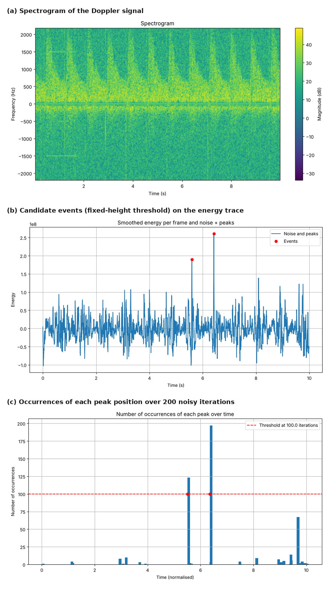

# Embolism Detection in Doppler Ultrasound Signals

Signal-processing pipeline that flags candidate embolic events in a Doppler ultrasound recording, using short-time spectral energy, background subtraction and repeated noisy peak detection.

<p align="center">
  
</p>

> **Status.** Exploratory analysis written in 2024, not actively maintained. It is demonstrated on a single recording without reference annotations, so detection performance (sensitivity, false-alarm rate) has **not** been measured.

> **Context.** Developed in 2024 during my engineering studies at [ESEO](https://www.eseo.fr), within study and research projects carried out in collaboration with ESEO. Exploratory scope: this is not a clinical study and makes no claim of clinical validity.

| | |
|---|---|
| **Input** | Stereo WAV, 4,398 Hz, 871 s, read as a complex quadrature signal. A 10 s segment is analysed. |
| **Output** | Times of candidate embolic events. On the analysed segment: 2 events, at 5.50 s and 6.35 s. |
| **Evaluation** | None (no labelled events). |
| **Code** | Python notebook, NumPy / SciPy / Matplotlib. |

## Overview

Embolic events appear in Doppler signals as short, high-intensity transients on top of background noise. The pipeline estimates a short-time energy trace, subtracts a smoothed background, and detects transients that stand out from it. Peaks that also appear in the negative-frequency energy are treated as artefacts and discarded.

## Method

All steps are in [`notebooks/embolism_detection.ipynb`](notebooks/embolism_detection.ipynb).

1. Load the WAV file, build the complex signal and select a 10 s segment (0-10 s).
2. Frequency spectrum and spectrogram of the segment.
3. Short-time energy: 64-sample Hamming windows, 80 % overlap, 512-point FFT.
4. Background estimation by low-pass Butterworth smoothing, subtraction and outlier removal.
5. Detection, in three variants:
   - fixed-height peak detection (threshold `1.5e8`);
   - distance of the trace to a smoothed negative envelope;
   - 200 repetitions with added Gaussian noise (fixed seed), keeping positions detected in more than 100 of them.
6. Artefact handling: peaks above the 99th percentile of the negative-frequency energy are treated as artefacts, and detections that coincide with them are discarded.

## Results (notebook outputs)

- Fixed-threshold detection: 2 candidate events in the analysed segment.
- Repeated noisy detection: the same 2 events, at 5.50 s and 6.35 s; both exceed the 100-repetition threshold and no other position does (panel c). They are unchanged after artefact suppression.

Without annotations, it cannot be said whether these are true embolic events.

## Limitations

- One recording; only its first 10 s (of 871 s) are analysed.
- Thresholds and filter parameters are set by hand; there is no labelled data and no cross-validation.
- The repeated-detection step depends on a random noise realisation. Before the seed was fixed, the reported times varied from run to run: 4.96 s and 5.91 s in the original 2024 outputs, 5.34 s and 6.23 s in one re-run (always 2 events). The times above are those of seed 0 and should be read with an uncertainty of the order of 0.5 s.

## Repository structure

```
notebooks/embolism_detection.ipynb   analysis notebook
data/T54_a.wav                       input recording
data/README.md                       data description
assets/overview.png                  figure above (from the notebook outputs)
requirements.txt
CITATION.cff
LICENSE
```

## Reproducing

```bash
python -m venv .venv && source .venv/bin/activate
pip install -r requirements.txt
cd notebooks && jupyter lab        # open embolism_detection.ipynb and run all cells
```

The notebook was re-executed end to end (no errors) with Python 3.13, NumPy 2.5.3, SciPy 1.18.1 and Matplotlib 3.11.2; the saved outputs and figures come from that run. Window functions are imported from `scipy.signal.windows`, because `hamming` and `kaiser` were removed from `scipy.signal` in recent SciPy releases.

## Citation and licence

See [`CITATION.cff`](CITATION.cff). Code released under the [MIT licence](LICENSE). The recording is not covered by this licence (see [`data/README.md`](data/README.md)).

Author: Jean-Eudes Beucher
